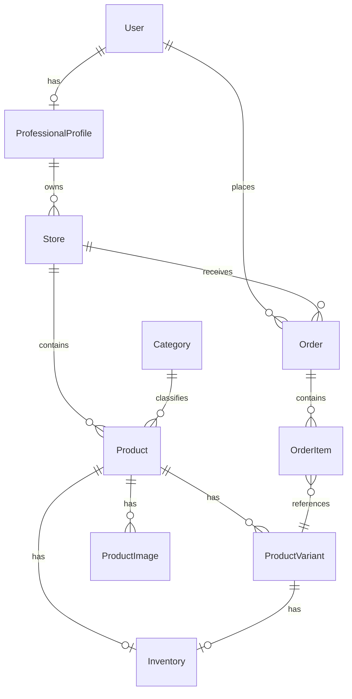

# Diagramme entité-relation

> **Section** : 05-data
> **Statut** : 🚧 Draft
> **Dernière mise à jour** : 2026-10-10

## Mermaid ER

## Cardinalités

| Relation | Cardinalité |
|---|---|
| User → ProfessionalProfile | 1-1 |
| ProfessionalProfile → Store | 1-N |
| Store → Product | 1-N |
| Product → ProductVariant | 1-N |
| Product → ProductImage | 1-N |
| Product → Inventory | 1-0..1 |
| ProductVariant → Inventory | 1-0..1 |

---

## Statut du document

| Champ | Valeur |
|---|---|
| Version | 0.1.0 |
| Statut | 🚧 Draft |
| Auteur | — |
| Relecteurs | — |
| Dernière mise à jour | 2026-10-10 |

## Historique

| Date | Version | Changement | Auteur |
|---|---|---|---|
| 2026-10-10 | 0.1.0 | Création initiale | — |
