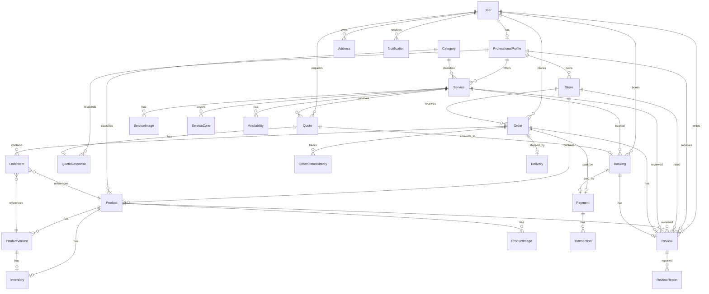
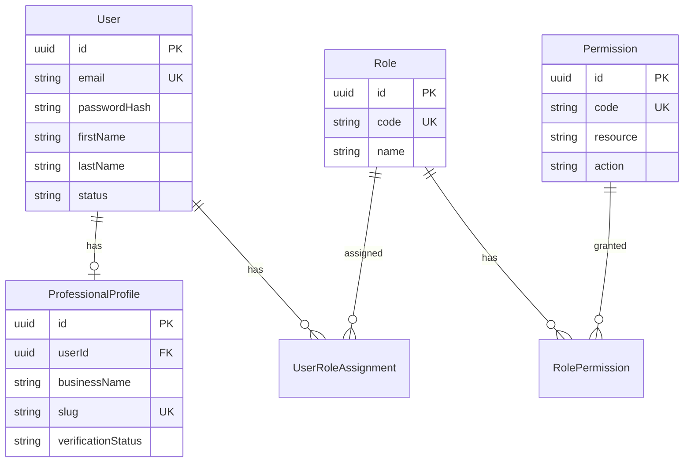
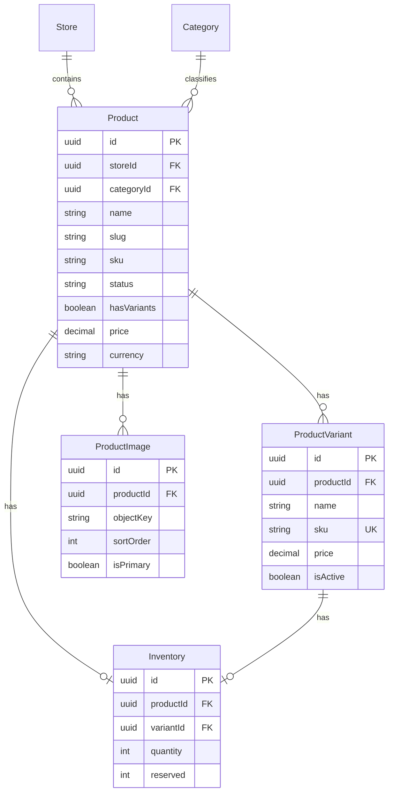
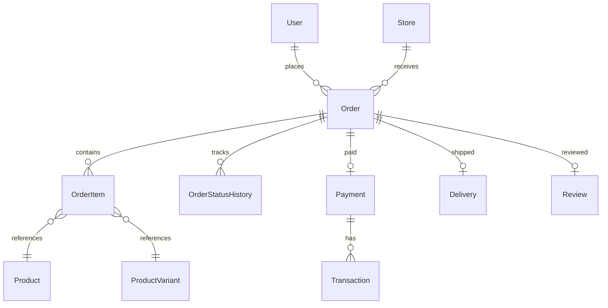
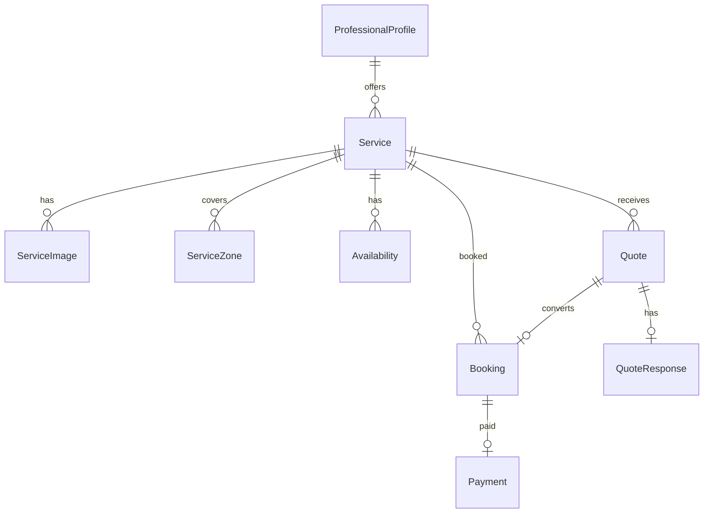

# Diagramme entité-relation

> **Section** : 05-data
> **Statut** : 🚧 Draft
> **Dernière mise à jour** : 2026-10-11

## Mermaid ER global

## Détails par contexte

### Identity

### Catalog

### Order

### Service (Phase 2)

## Cardinalités

| Relation | Cardinalité | Contrainte |
|---|---|---|
| User → ProfessionalProfile | 1-0..1 | 1 profil par user |
| User → Address | 1-N | N adresses |
| User → Order | 1-N | Historique |
| ProfessionalProfile → Store | 1-N | Plusieurs boutiques |
| Store → Product | 1-N | Catalogue |
| Product → ProductVariant | 1-N | Si hasVariants |
| Product → ProductImage | 1-N | Plusieurs images |
| Product → Inventory | 1-0..1 | Si produit simple |
| ProductVariant → Inventory | 1-0..1 | Une par variante |
| Order → OrderItem | 1-N | Lignes |
| Order → Payment | 1-0..1 | Un paiement |
| Order → Delivery | 1-0..1 | Une livraison |
| Order → Review | 1-0..1 | Un avis |
| Service → Quote | 1-N | Demandes |
| Quote → Booking | 1-0..1 | Conversion |
| Booking → Payment | 1-0..1 | Un paiement |

## Relations critiques

### XOR contraintes

| Table | Contrainte |
|---|---|
| inventory | product_id XOR variant_id |
| order_items | product_id XOR variant_id |
| payments | order_id XOR booking_id |

### Unicité

| Table | Contrainte |
|---|---|
| users | email |
| professional_profiles | user_id, slug |
| stores | slug |
| products | (store_id, slug) |
| product_variants | sku |
| payments | provider_ref |
| reviews | order_id, booking_id |
| idempotency_keys | (key, scope) |
| bookings | (service_id, scheduled_at) |

### Index partiels

| Table | Index | Condition |
|---|---|---|
| product_images | unique (product_id) | WHERE is_primary = TRUE |
| service_images | unique (service_id) | WHERE is_primary = TRUE |
| addresses | unique (user_id) | WHERE is_default = TRUE |

## Cardinalités par volume

| Table | Volume An 1 | Volume An 3 |
|---|---|---|
| users | 2 000 | 60 000 |
| professional_profiles | 100 | 2 000 |
| stores | 120 | 2 500 |
| products | 2 000 | 50 000 |
| product_variants | 8 000 | 200 000 |
| product_images | 10 000 | 300 000 |
| inventory | 8 000 | 200 000 |
| orders | 5 000 | 200 000 |
| order_items | 15 000 | 600 000 |
| payments | 4 500 | 180 000 |
| reviews | 1 000 | 60 000 |
| notifications | 20 000 | 1 000 000 |
| audit_logs | 50 000 | 5 000 000 |

## Décisions de modélisation

1. **UUID partout** — Pas d'IDs auto-incrémentés exposés (IDOR)
2. **Soft delete via status** — Pas de suppression physique
3. **Snapshot dans OrderItem** — Préserver l'historique
4. **Index partiels** — Pour les unicités conditionnelles
5. **CHECK constraints** — Pour les invariants critiques
6. **Audit séparé** — Table `audit_logs` indépendante

---

## Statut du document

| Champ | Valeur |
|---|---|
| Version | 0.2.0 |
| Statut | 🚧 Draft |
| Auteur | — |
| Relecteurs | — |
| Dernière mise à jour | 2026-10-11 |

## Historique

| Date | Version | Changement | Auteur |
|---|---|---|---|
| 2026-10-10 | 0.1.0 | Création initiale | — |
| 2026-10-11 | 0.2.0 | Intégration vision place de marché hybride | — |
